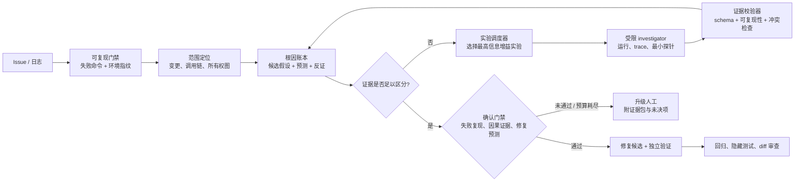
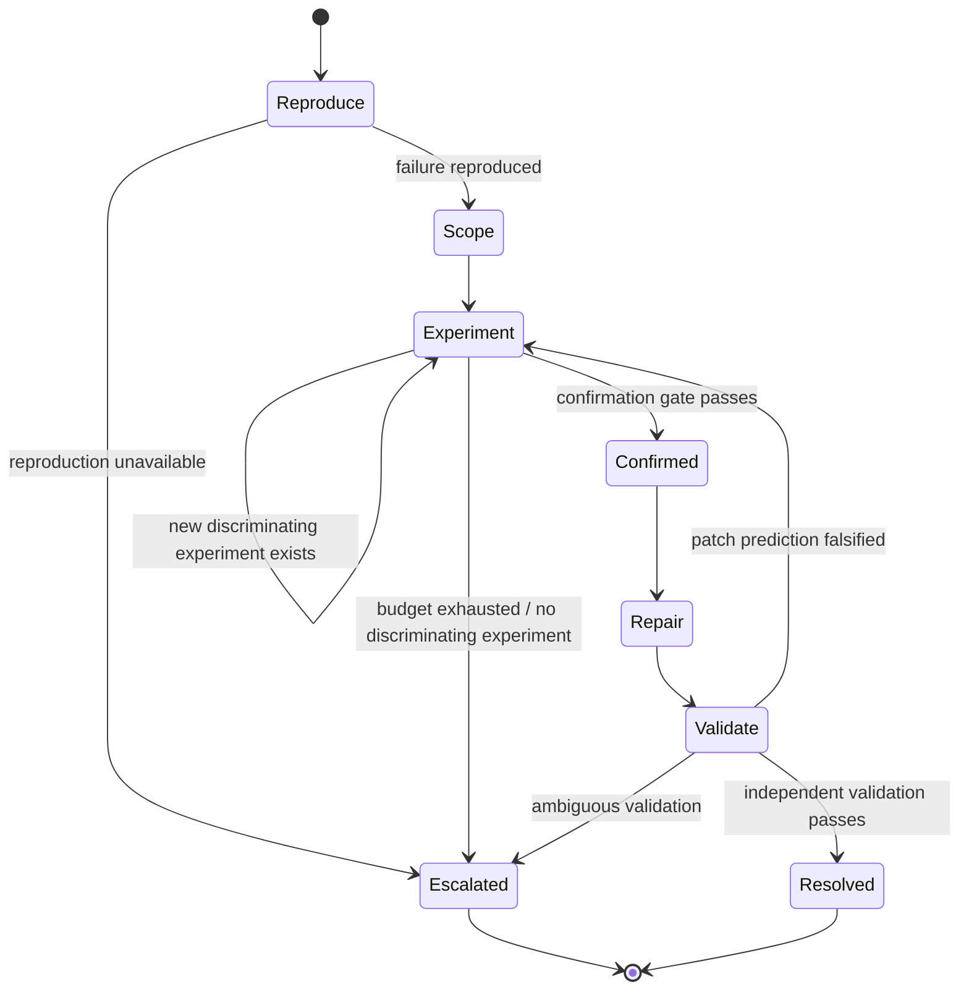

# Bugfix 多仓多 Agent 工作流：证据化诊断与演进方案

> 版本：2026-09-29  
> 范围：基于所给工作流描述与公开的一手工程资料、同行评审/预印本研究进行架构诊断。  
> 证据边界：本文将**观测事实**、**由设计直接推出的结论**与**待验证风险**严格分开。没有运行 trace、提示词、工具调用、报告正文和测试产物的地方，不对模型行为或单次失败原因作断言。

## 执行结论

当前系统的主要问题不是“Agent 数量不足”，而是定位循环缺少一个可检验、可终止的**诊断协议**。系统能不断产生报告、审查和 belief-state 更新，却没有把“下一轮调查”限制为能区分候选根因的最小实验。因此，第二、三轮仍对同一个 CodeMate-WebView 做动态调查，但输入描述中没有记录新的可证伪预测、实验条件或信息增益；这能解释“耗时增长而结论不收敛”的结构性现象。

应把 Phase 3 从“调查 → 审查 → 记录 → 再调查”的文档流水线，改为“**故障可复现 → 候选根因账本 → 最小区分实验 → 证据门禁 → 可验证修复**”的闭环。多 Agent 只用于彼此独立、可并行、且能降低不确定性的子问题；定位的根因裁决、状态写入和停止决策必须收敛到一个受 schema 和测试约束的控制面。

## 0. 交叉验证结果

上述结论经过两条独立验证：架构推演按仓库实现与时间账本复核；外部资料按原始论文和工程文档核对。交叉验证后的变化如下。

1. **确认为主根因**：缺少可证伪诊断协议。当前新设计已引入 Observed/Expected、复现、证据和开放问题等字段，但仍是 prompt 约束；没有机器可校验的 falsifier、artifact hash、snapshot version 和 discriminating-experiment gate。
2. **确认为 P0**：未收敛仍进入修复。三轮 verdict 均为 `NEEDS_DYNAMIC_INVESTIGATION`，但 Phase 4 读取 `confirmed_root_cause`。固定轮次是成本上限，不能赋予确认语义。
3. **确认为度量缺陷**：Phase 3 逐项相加的关键路径为 270.5m，而非输入中的约 168m；hypothesis-manager 为 27.4m，而非 30m。先统一 wall-clock / active / queue / tool 口径，再讨论性能优化。
4. **降级为待验证假设**：“primary agent 共享上下文即零损耗”没有运行 trace 或消融证明；“permission 是安全边界”应改为操作门禁，真实隔离依赖容器/VM 与最小权限；“只派发 referee”目前是行为提示，当前 task 权限不能按 agent 名过滤。
5. **实现漂移告警**：旧 harness 仍引用已删除的 `bug-fix` / `bug-fix-verifier`，GitHub workflow 仍调用旧入口；新路径使用 `repair` / `referee`。必须统一入口或显式废弃旧 CI，否则测试通过不代表运行路径一致。
6. **外部资料审计**：核心引用真实且支持对应论断；MAST 论文的准确口径是 7 个框架、1600+ annotated traces，其中 150 traces 形成分类法。2026 年新增研究有效，但应随版本更新复核。

## 1. 已知工作流与事实账本

### 1.1 现有流程的结构事实

| 项目 | 从输入可直接确认的事实 |
|---|---|
| 拓扑 | team-leader 负责任务发布、调度与 wait；investigator 与 locate-reviewer 可通过 P2P `send-message` 直接通信。 |
| 状态 | `belief-state.json` 贯穿流程；team-leader 与 hypothesis-manager 都被描述为会更新它。 |
| 定位迭代 | Phase 3 有三轮：Round 1 是 4 个仓库的静态调查；Round 2、3 都是 CodeMate-WebView 的动态调查。 |
| 审查结果 | 三次 locate-reviewer verdict 都为 `NEEDS_DYNAMIC_INVESTIGATION`。 |
| 串行约束 | 每轮中 investigator 完成后才调 reviewer，随后 `RECORD` 与 `APPLY_REVIEW` 串行执行。 |
| P2P 补证 | Round 1 有 2 次请求/回复，Round 2 有 1 次请求/回复，Round 3 有 1 次请求（输入未记录对应回复）。 |
| 下游假设 | repair-planner 读取 `confirmed_root_cause`；而输入同时说明三轮均未收敛。 |

### 1.2 时间账本：输入中的数据并不自洽

下表只使用原始描述列出的分钟数；“最短串行路径”按其中声明的顺序计算，并将 Round 1 的 4 个 investigator 取最长的 60.6 分钟。

| 轮次 | investigator 阶段（关键路径） | reviewer | hypothesis-manager | 最短串行路径 |
|---|---:|---:|---:|---:|
| Round 1 | 60.6m | 64.0m | 10.2m | **134.8m** |
| Round 2 | 40.2m | 22.6m | 9.8m | **72.6m** |
| Round 3 | 45.1m | 10.6m | 7.4m | **63.1m** |
| Phase 3 合计 | 145.9m | 97.2m | 27.4m | **270.5m** |

这与“Phase 3 约 168m”不兼容，除非至少有一项成立：分钟数不是 wall-clock、阶段存在未披露重叠、或原始统计有误。它也与“hypothesis-manager 30m”不完全一致（逐项相加为 27.4m）。因此，当前无法据此可靠计算吞吐量、成本或优化后的节省；首先要统一指标定义。

另一个有价值但不能过度解读的信号是：Round 1 的 reviewer 单步 64m，超过该轮最长 investigator（60.6m），说明该轮的审查阶段本身是关键路径的一部分，而不是轻量收敛器。

### 1.3 研究和业界事实（与本案的关系）

1. Anthropic 在其生产级研究系统复盘中报告：多 Agent 的收益主要来自给真正可并行的问题增加推理/工具容量；但其观察也明确指出，许多编码任务可真正并行的部分更少，实时协调与委派仍是弱项。[多 Agent Research 系统](https://www.anthropic.com/engineering/multi-agent-research-system)
2. OpenAI 的编排指南建议：只有当 specialist 能在能力隔离、策略隔离、提示清晰度或 trace 可读性上带来实质收益时才增加；manager 保持最终所有权时，应将 specialist 作为受限能力调用。[Orchestration and handoffs](https://developers.openai.com/api/docs/guides/agents/orchestration)
3. 对 coding agent，来自运行环境的 ground truth（测试、命令输出、实际运行结果）是循环的必要反馈，而停止条件用来限制无限迭代；自动化测试能验证功能，但不替代人类对更广泛需求的审查。[Building Effective AI Agents](https://www.anthropic.com/engineering/building-effective-agents)
4. OpenAI 将端到端 trace（模型调用、工具调用、guardrail、handoff）和针对 trace 的结构化 grader 作为定位工作流级失败的起点；可重复比较则需要数据集与 eval run。[Evaluate agent workflows](https://developers.openai.com/api/docs/guides/agent-evals)
5. 软件工程 Agent 研究表明，专门的 agent-computer interface 会显著改变代码导航、编辑和测试的效果；因此“给更长 prompt / 多派几个 Agent”不能替代可用的检索、执行与测试工具。[SWE-agent](https://arxiv.org/abs/2405.15793)
6. Agentless 的结果说明，在仓库级修复上，明确的“定位 → 修复 → patch 验证”三段式可以成为值得比较的强基线；这不是多 Agent 无效的证据，而是要求多 Agent 必须通过消融证明增益。[Agentless](https://arxiv.org/abs/2407.01489)
7. 近期对 SWE-bench Verified 的实证研究发现，部分被判为正确的 patch 仍无法通过开发者编写的测试套件。由此可得：单一自动评测或“能过当前测试”不能单独作为根因已确认的证据。[Are “Solved Issues” in SWE-bench Really Solved Correctly?](https://arxiv.org/abs/2503.15223)

## 2. 当前失败的原因：证据化诊断

### A. 已被工作流直接支持的缺陷

| 优先级 | 发现 | 支撑事实 | 为什么会损害定位 |
|---|---|---|---|
| P0 | **停止条件与下游前置条件矛盾** | 三轮均为 `NEEDS_DYNAMIC_INVESTIGATION`，但 Phase 4 假定存在 `confirmed_root_cause`。 | 系统没有定义“未确认时如何退出”：继续、降级、人工裁决还是禁止修复。固定轮次会把未收敛状态伪装成流程完成。 |
| P0 | **无最小区分实验契约** | review JSON 只有 `verdict + evidence_gaps` 的描述；没有要求候选假设、可观察预测、反证标准、执行命令或实验结果。 | “需要动态调查”不是可执行的诊断任务。下一轮无法证明它比上一轮更接近区分哪个根因。 |
| P0 | **重复调查没有记录新信息条件** | Round 2 与 Round 3 都调查 CodeMate-WebView，且均未收敛；输入未描述二者不同的触发路径、观测指标或 falsifier。 | 重复调用相同能力可能增加 token/时间，却不必然增加证据独立性或信息增益。 |
| P1 | **审查是长关键路径但输入不够结构化** | Round 1 reviewer 为 64m；report 为 Markdown，审查产物才是 JSON。 | 审查者需要从自由文本中重建比较维度，容易把证据提取、冲突解析、任务规划混为一个长回合。 |
| P1 | **状态所有权不单一** | team-leader 与 hypothesis-manager 都会更新 `belief-state.json`；reviewer 与 investigator 又有旁路 P2P。 | 没有版本号、写入租约或事件日志时，无法从描述证明每个决策使用的是同一证据快照；这是一致性风险，不是已发生的数据丢失结论。 |
| P1 | **缺少可审计的端到端指标** | Phase 3、manager 总时长与阶段占比口径彼此冲突；没有 token、工具调用、重试、队列、cache、测试结果字段。 | 不能区分“模型推理慢”“工具慢”“排队慢”“审查反复”“上下文膨胀”，也无法做可信的优化归因。 |

### B. 当前不能下结论、必须用 trace 验证的事项

下列说法在现有材料中均**没有证据**：模型是否幻觉、某仓库是否本来无 bug、动态工具是否失败、reviewer 是否读错报告、belief-state 是否真的发生竞争写入、或某个 Agent 的 prompt 是否差。后续必须以 trace、命令输出、测试工件、版本化状态和人工标注判定，不能以一次结果反推原因。

## 3. 目标架构：以诊断闭环取代报告闭环



### 3.1 控制面：一个状态写入者、不可变证据事件

将 `belief-state.json` 拆为：

* `case.json`：只保存当前 case 的版本、状态机阶段、预算、最后一次决策；由 **case-controller** 单写。
* `evidence.ndjson`：每条证据一个不可变事件，含 artifact hash、生成 Agent、命令、时间、仓库 revision 和重现结果。
* `hypotheses.json`：由 case-controller 从事件流物化；每个假设有 prior、支持/反驳证据、预测与 next experiment。
* `decision.json`：每次 continue / confirm / escalate 的输入 snapshot hash、规则命中项、预算消耗和责任 Agent。

P2P 消息可以保留，但它们只能创建“补证请求/答复事件”，不能直接改变假设权重或通过确认门禁。这样保留低延迟协作，同时让控制面可回放。

### 3.2 证据契约：从自由报告改为可校验的最小单元

每一次 investigation 必须产生以下 schema（自由文本只可作为 `notes` 附件）：

```json
{
  "case_id": "…",
  "hypothesis_id": "H-03",
  "claim": "WebView 初始化时读取了过期配置",
  "prediction": "在复现步骤 S 的 trace 中，配置读取发生在刷新事件之前",
  "method": {"command": "…", "environment": "container digest / revision"},
  "observation": "可引用的 trace、日志行、测试输出或代码位置",
  "supports": ["H-03"],
  "contradicts": ["H-01"],
  "falsifier": "若读取发生在刷新后，则拒绝 H-03",
  "reproducible": true,
  "artifact_refs": ["sha256:…"],
  "next_experiment": "仅当仍不能区分 H-02/H-03 时填写"
}
```

证据校验器应拒绝没有预测、没有观测、没有可重现命令、或只含主观 confidence 的结果。对每一轮只允许安排能区分至少两个仍存活假设的实验；否则直接升级人工或停止，不能以“再动态调查一次”作为默认动作。

### 3.3 调度面：少而有界的并行，围绕独立证据

| 阶段 | 默认并发 | Agent 责任 | 可进入下一步的门禁 |
|---|---:|---|---|
| 0. Reproduce | 1 | reproduction agent | 固定失败命令、版本、环境与最小复现；失败则先标记为不可复现。 |
| 1. Scope | 1 + 可选 1 | locator / codegraph query | 产出候选文件/调用链/ownership；并发仅用于独立仓库或独立执行环境。 |
| 2. Hypothesize | 1 | case-controller | 候选互斥或可区分、每个有预测与反证。 |
| 3. Experiment | 1–3 | investigator as bounded tool | 每个任务绑定一个 hypothesis pair 和预算；不同实验必须有不同信息目标。 |
| 4. Verify | 1 | evidence verifier | 检查 schema、可重现性、证据新颖度、与账本的一致性。 |
| 5. Repair | 1 | fix agent | patch 必须声明它满足的预测。 |
| 6. Validate | 1（独立上下文） | validation agent | 原始复现、目标测试、回归/契约测试和 diff 语义审查。 |

定位是高耦合的因果推断任务，默认应使用一个“case owner + 受限工具专家”的 manager-as-tools 模式。仅当实验之间不共享环境/状态、输出可以用 schema 合并、且能够说明它们分别排除什么候选时才并发。这个选择与 OpenAI 的 specialist 增量原则，以及 Anthropic 对编码任务可并行度有限的生产观察一致。[OpenAI 编排指南](https://developers.openai.com/api/docs/guides/agents/orchestration) [Anthropic 多 Agent 复盘](https://www.anthropic.com/engineering/multi-agent-research-system)

### 3.4 状态机与明确停止规则



确认门禁不能只看 reviewer verdict。建议要求以下三个条件同时成立：

1. **现象**：原始失败可在固定 revision/environment 下复现；
2. **因果**：观测满足候选根因的预测，并排除了至少一个强竞争候选；
3. **干预**：最小 patch 或实验性开关按预测改变失败现象，且独立验证未发现明显回归。

如果 3 个条件未满足，状态必须是 `ESCALATED` 或 `UNRESOLVED`，不能写入 `confirmed_root_cause`。固定最多 3 轮可以作为成本上限，但不是“视为确认”的替代条件。

## 4. 分阶段演进路线

### 第 1 周：先让失败可见（不增加 Agent）

* 为每个 run 记录统一的 `run_id / case_id / parent_span_id / agent / model / prompt_version / tool / repo_revision / wall_time / active_time / token / result`；把 wait、P2P 与状态写入也做成 span。
* 定义时间口径：wall-clock、关键路径、Agent active time、队列等待、工具等待、token time 必须分列；Phase 总时长只能引用一个口径。
* 建 20–50 个脱敏历史 bug case 的离线集，标注“是否复现、定位文件/符号、根因、验证测试”。不要先以单一 benchmark 分数决定架构。
* 新增 4 个 trace grader：`reproduction_present`、`hypothesis_has_falsifier`、`experiment_is_discriminating`、`state_snapshot_consistent`。

### 第 2–3 周：把定位改成实验驱动

* 用上述 evidence schema 替换 investigator Markdown 作为决策输入；Markdown 退为证据附件。
* 合并 team-leader/hypothesis-manager 的写权限，创建 case-controller 单写者和 append-only evidence log。
* 为 reviewer 加硬预算（例如一次结构化判定 + 最多一次基于具体 schema 缺失的补证）；超过预算就升级，不允许无界对话。
* 将 Round 2/3 的默认任务改成“区分 H-x 与 H-y 的实验”，并要求在调度前写明预计观察与停止条件。

### 第 4–6 周：用消融证明多 Agent 是否值得保留

对同一冻结 case 集、同一模型/工具版本/预算，至少比较下列配置：

| 配置 | 用途 |
|---|---|
| S0：单 Agent，定位→修复→验证 | 成本与成功率基线。 |
| S1：单 case owner + 结构化工具/证据协议 | 判断问题是否主要来自工具和契约。 |
| M1：S1 + 仅独立实验并发 | 衡量受限并发的增益。 |
| M2：当前式 reviewer + P2P + 三轮 | 作为遗留对照，而非默认。 |

只有在成功率、定位准确率或 p95 wall-clock 达到预设改善，且单位成功 case 成本不恶化时，才保留对应多 Agent 分支。将“架构复杂度是否值得”作为可测假设，而不是信念。

## 5. 生产指标与验收标准

| 维度 | 指标 | 计算方式 | 防止的假象 |
|---|---|---|---|
| 定位质量 | Root-cause precision / recall | 人工/已知根因与最终定位的 case-level 对比 | “报告写得像答案”被当作定位成功。 |
| 诊断质量 | Discriminating-evidence rate | 有明确预测且实际排除/支持竞争假设的实验 ÷ 全部实验 | 反复搜集同类证据。 |
| 修复质量 | Independent validation pass rate | 独立上下文运行复现、目标、回归测试后通过的 patch 比例 | 自己给自己判通过。 |
| 效率 | Time-to-first-repro、time-to-confirm、p50/p95 wall-clock | 从 case 创建到对应状态转换 | 只看 Agent 工时，忽略用户等待。 |
| 资源 | Cost per validated resolution | token + 工具 + 容器/CI 成本 ÷ 独立验证通过的 case | 以总任务数稀释失败成本。 |
| 收敛 | Unresolved/escalated rate、平均有效实验数 | 按停止原因和有信息量实验计数 | 用固定轮数掩盖不确定性。 |
| 可靠性 | State version conflict、missing-artifact rate | 写入冲突/缺失可重现工件占比 | 看不到控制面一致性故障。 |

验收时应优先报告置信区间、case 分层（单仓/多仓、可复现/不可复现、静态/动态）和失败样本，而不是只报告一个均值。Agent 评估是多轮系统评估；trace → grader → 数据集 → 反复 eval 的顺序，符合当前公开的工程建议。[OpenAI agent evals](https://developers.openai.com/api/docs/guides/agent-evals) [Anthropic agent evals](https://www.anthropic.com/engineering/demystifying-evals-for-ai-agents)

## 6. 立即可执行的决策

1. **暂停“固定三轮后进入 repair”规则**：改为确认门禁或 `ESCALATED`，这是消除错误修复风险的第一优先级。
2. **下一次只运行一个 case**：先完成复现、候选账本和一个最小区分实验；不要先并行四个宽泛 investigator。
3. **把 reviewer 的输出改成 machine-checkable decision**：必须列出存活假设、已满足/缺失的证据和唯一下一实验；没有下一实验即升级。
4. **补全 trace 后再讨论模型、prompt 或 Agent 数量**：目前的时间统计不足以支持那些归因。
5. **以 S0/S1/M1/M2 消融结果决定长期拓扑**：多 Agent 是待验证的性能优化，不应作为定位正确性的前提。

## 参考资料

1. Anthropic, *How we built our multi-agent research system*, 2025-06-13. https://www.anthropic.com/engineering/multi-agent-research-system
2. OpenAI, *Orchestration and handoffs*, accessed 2026-09-29. https://developers.openai.com/api/docs/guides/agents/orchestration
3. Anthropic, *Building Effective AI Agents*, 2024-12-19. https://www.anthropic.com/engineering/building-effective-agents
4. OpenAI, *Evaluate agent workflows*, accessed 2026-09-29. https://developers.openai.com/api/docs/guides/agent-evals
5. Yang et al., *SWE-agent: Agent-Computer Interfaces Enable Automated Software Engineering*, 2024. https://arxiv.org/abs/2405.15793
6. Xia et al., *Agentless: Demystifying LLM-based Software Engineering Agents*, 2024. https://arxiv.org/abs/2407.01489
7. *Are “Solved Issues” in SWE-bench Really Solved Correctly? An Empirical Study*, 2025. https://arxiv.org/abs/2503.15223
8. Anthropic, *Demystifying evals for AI agents*, 2026-01-09. https://www.anthropic.com/engineering/demystifying-evals-for-ai-agents
